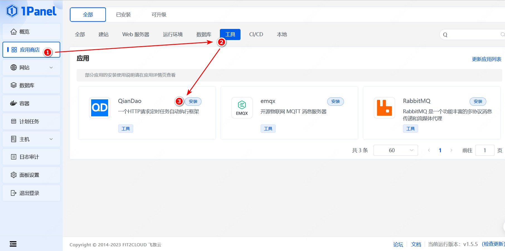
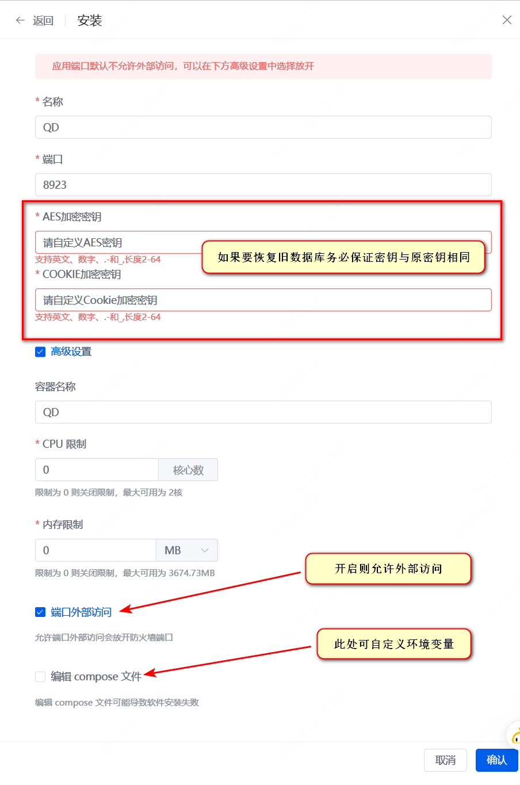

# 部署

## Docker 容器部署

Docker 容器部署是部署 QD 的最简单方式。

> 操作前请一定要记得备份数据库!!!

### 容器

**DockerHub 网址**：[https://hub.docker.com/r/qdtoday/qd](https://hub.docker.com/r/qdtoday/qd)

> Tag 含义:
>
> - `latest`: 最新 Release 版本, 含 OCR (验证码识别) 功能
> - `lite-latest`: 去除 OCR 相关功能的最新 Release 版本, 体积最小
> - `ja3-latest`: 与 `latest` 相同, 但集成 curl-impersonate 解决 ja3 指纹被识别为 curl 的问题, 不支持 http3 和 Quic 连接
> - `ja3-lite-latest`: 与 `lite-latest` 相同, 但集成 curl-impersonate, 体积最小且能通过 ja3 指纹检测
> - `20xxxxxx`: 指定 Release 版本, 版本号表示为 Release 发布日期。同样有四种口味, 分别是 `ja3-20xxxxxx`、`lite-20xxxxxx`、`ja3-lite-20xxxxxx`
> - `dev`: 最新开发版, 同步最新源码, 不保证稳定性。同样有四种口味, 分别是 `lite-dev`、`ja3-dev`、`ja3-lite-dev`
>
> 架构说明: OCR 相关依赖在 `386`、`arm/v6`、`s390x` 上没有可用的 musllinux 轮子。这三个架构上 `latest` 仍可拉取, 但该平台的内容等同于 `lite-latest` (不含验证码识别); `ja3-latest` 在 `386`、`arm/v6` 上等同于 `ja3-lite-latest`, 在 `s390x` 上不提供。需要验证码识别请使用 `amd64`、`arm64`、`arm/v7`、`ppc64le`、`riscv64`、`loong64`。

### 部署方法

#### 1. Docker Compose（推荐）

``` sh
# 创建并切换到 QD 目录。
mkdir -p $(pwd)/qd/config && cd $(pwd)/qd
# 下载 docker-compose.yml
wget https://fastly.jsdelivr.net/gh/qd-today/qd@master/docker-compose.yml
# 根据需求和配置说明修改配置环境变量
vi ./docker-compose.yml
# 执行 Docker Compose 命令
docker-compose up -d
```

> 配置描述见下文 [Configuration](#配置环境变量)
>
> 如不需要`OCR功能`或者`硬盘空间不大于600M`, 请使用 **`qdtoday/qd:lite-latest`** 镜像, **该镜像仅去除了OCR相关功能, 行为与主线版本保持一致**。
>
> **请勿使用 阿里云镜像源 拉取 Docker 容器, 会导致无法拉取最新镜像**

#### 2. 1Panel 部署

2.1. 在 1Panel 中创建一个新的应用

   

   > 不同 1Panel 版本显示 QD 框架名称可能不同, 但均为 `QD` 图标.

2.2. 配置相关设置

   

   > 如需设置环境变量请点击 `编辑 Compose 文件`
   >
   > 配置描述见下文 [Configuration](#配置环境变量)
   >
   > 如不需要`OCR功能`或者`硬盘空间不大于600M`, 请使用 **`qdtoday/qd:lite-latest`** 镜像, **该镜像仅去除了OCR相关功能, 行为与主线版本保持一致**。

2.3. 点击 `确认` 即可通过 1Panel 安装 QD

#### 3. Docker 运行

``` sh
docker run -d --name qd -p 8923:80 -v $(pwd)/qd/config:/usr/src/app/config qdtoday/qd
```

容器内部无法连通外部网络时尝试该命令:

``` sh
# 使用 Host 网络模式创建容器, 端口号: 8923
docker run -d --name qd --env PORT=8923 --net=host -v $(pwd)/qd/config:/usr/src/app/config qdtoday/qd
```

> 注意: 使用该命令创建容器后, 请将模板里 `http://localhost/` 形式的 api 请求, 手动改成 `api://` 或 `http://localhost:8923/` 后, 才能正常完成相关API请求。
>
> **请勿同时运行新旧版 QD 框架, 或将不同运行中的 QD 容器数据库映射为同一文件。**

## 源码部署

1. **Version >= python3.9**

   ``` sh
   # 请先cd到框架源码根目录
   pip3 install -r requirements.txt
   ```

2. **修改相关设置**

   ``` sh
   # 执行以下命令复制配置文件
   # 修改 local_config.py 文件的内容不受通过 git 更新源码的影响
   cp config.py local_config.py
   # 根据需求和配置说明修改配置文件或环境变量值
   vi local_config.py
   ```

3. **启动**

   ``` sh
   python ./run.py
   ```

4. **访问**

   ``` sh
   # 访问网页
   http://localhost:8923/
   ```

   > 如果您使用的是源码部署方式，请手动将模板中 `http://localhost/` 形式的 api 请求改为 `api://` 或 `http://localhost:8923/` ，以便正确完成相关API 请求。
   >
   > 模板需要发布才会在「公开模板」中展示, 你需要管理员权限在「我的发布请求」中审批通过。

## 设置管理员

``` sh
python ./chrole.py your@email.address admin
```

> 首位注册用户默认为管理员, 需要先登出再登陆后才能获得完整管理员权限

## 会话密钥

会话 Cookie 使用 `COOKIE_SIGN_SECRET` 签名。未设置时, 每次启动都会随机生成一份并只保存在内存中, 因此**服务或容器重启后所有登录状态失效, 需要重新登录**; 该密钥不会写入磁盘。

多实例 / 多容器共用同一数据库时, 必须为所有实例设置同一个密钥, 否则登录状态会随请求落到不同实例而随机失效:

``` sh
# 生成一个随机密钥 (只需生成一次, 妥善保存)
openssl rand -hex 32
```

``` yaml
environment:
  - COOKIE_SIGN_SECRET=<上面生成的值>
```

> 更换该密钥 (或删除后让程序重新随机生成) 会使**所有已登录会话立即失效**, 用户需重新登录; 数据库中的任务、模板、变量与凭据不受影响。
>
> `COOKIE_SECRET` 已弃用并默认忽略, 请勿再使用。

## 轮换 AES_KEY

`AES_KEY` 是数据库的数据加密密钥, 用于加密 `user.userkey` (用户凭据), 以及 `userid` 为空的公共模板数据 (`tpl.har` / `tpl.tpl` / `task.init_env` / `task.env`)。

默认值 `binux` 是公开的, 仅适合完全内网自用; 数据库或备份一旦泄露, 用户凭据即可被离线解密。

> **直接改 `AES_KEY` 环境变量会让存量数据无法解密**: 登录时报 500 (`decrypt error`), 已保存的任务与公共模板也读不出来。
> 必须先用 `tools/rotate_aes_key.py` 把存量数据迁移到新密钥, 再改环境变量。

迁移脚本先用旧密钥解密、再用新密钥加密, 并逐条回读校验; 任何一行失败即整体中止, 不落库。默认只试运行, 加 `--apply` 才真正写入。

覆盖范围: `user.userkey` (全部用户), 以及 `userid` 为 `0` 或 `NULL` 的公共数据 (`tpl.har` / `tpl.tpl` / `task.init_env` / `task.env` / `task.session`)。私有数据用各自的 `user.userkey` 加密, 该密钥的明文在轮换前后不变, 无需重新加密。

结束时会打印「重新加密 N 列, 跳过 M 列」。**M 不为 0 时必须查明原因** (明文列、非本框架加密的数据, 或 `--old` 填错), 不要直接当作成功。

### 源码部署

依赖由 uv 管理 (虚拟环境在 `.venv`), 脚本要在仓库根目录执行:

``` sh
cd /path/to/qd

# 1. 生成新密钥 (只需生成一次, 妥善保存)
openssl rand -hex 32

# 2. 停掉服务并备份数据库后, 先试运行
.venv/bin/python -m tools.rotate_aes_key --old binux --new <新密钥>

# 3. 确认输出无误后落库
.venv/bin/python -m tools.rotate_aes_key --old binux --new <新密钥> --apply

# 4. 设置 AES_KEY=<新密钥> 后再启动服务
```

sqlite 落库前会在数据库同目录留一份 `<库名>.aes-<时间戳>.bak`; MySQL 不做备份, 请自行保留 `mysqldump`。

### Docker 部署

镜像内代码在 `/usr/src/app`, 解释器是 `/usr/src/app/.venv/bin/python`, 数据库在挂载的 `config` 目录 (`/usr/src/app/config`)。用一次性容器执行迁移, 挂载与运行容器同一份数据目录:

``` sh
# 1. 停掉正在运行的容器 (避免迁移期间有任务或登录并发写库)
docker stop <容器名>

# 2. 备份数据库后, 用一次性容器执行迁移
docker run --rm -it \
  -v /宿主机路径/config:/usr/src/app/config \
  --entrypoint sh \
  <镜像名> -c "cd /usr/src/app && python -m tools.rotate_aes_key --old binux --new <新密钥> --apply"

# 3. 用新密钥启动容器
docker run -d --name qd -p 8923:80 \
  -v /宿主机路径/config:/usr/src/app/config \
  -e AES_KEY=<新密钥> \
  <镜像名>
```

MySQL 部署需要额外传入与运行容器相同的数据库环境变量, 让脚本连到同一个库:

``` sh
docker run --rm -it \
  -e DB_TYPE=mysql \
  -e JAWSDB_MARIA_URL='mysql://用户名:密码@hostname:3306/数据库名?auth_sqombs=' \
  --entrypoint sh \
  <镜像名> -c "cd /usr/src/app && python -m tools.rotate_aes_key --old binux --new <新密钥> --apply"
```

> `--old` 填**当前生效**的 AES_KEY 明文值; 如果之前已经设置过, 不要填默认值 `binux`。
>
> 迁移必须在服务停止后进行, 否则运行中的任务与登录请求会与迁移并发读写。
>
> 迁移完成并确认可用后, 可设置 `AES_KEY_STRICT=True` 让框架在 `AES_KEY` 仍是默认值时拒绝启动。

## 配置环境变量

变量名|是否必须|默认值|说明
:-: | :-: | :-: | :-:
BIND|否|0.0.0.0|监听地址
PORT|否|8923|监听端口
QD_DEBUG|否|False|是否启用Debug模式
WORKER_METHOD|否|Queue|任务定时执行方式, <br>默认为 Queue, 可选 Queue 或 Batch, <br>Batch 模式为旧版定时任务执行方式, 性能较弱, <br>**建议仅当 Queue 定时执行模式失效时使用**
MULTI_PROCESS|否|False|(实验性)是否启用多进程模式, <br>Windows平台无效
AUTO_RELOAD|否|False|是否启用自动热加载, <br>MULTI_PROCESS=True时无效
STATIC_URL_PREFIX|否|`/static/`|静态文件URL前缀
DOMAIN|否|''|指定访问域名, <br>**(建议修改)**, 否则通过邮件重置密码及邮箱推送等功能无效
AES_KEY|否|binux|数据库加密密钥, 用于加密数据库中的用户凭据等数据, **(新部署建议首次启动即设置; 修改前必须先迁移数据, 否则凭据不可解密)**, 迁移方法见 [轮换 AES_KEY](#轮换-aes_key)
AES_KEY_STRICT|否|False|为 True 时, 若 AES_KEY 仍为默认值则拒绝启动, **(需先完成数据迁移)**
COOKIE_SIGN_SECRET|否|每次启动随机生成|会话 Cookie 签名密钥, 不落盘; 未设置时每次启动随机生成, **重启后所有会话失效**, 多实例或多容器部署需显式设置; 也可在 local_config.py 中定义 cookie_secret 覆盖, **(原 COOKIE_SECRET 已弃用并默认忽略)**
COOKIE_DAY|否|5|Cookie在客户端中保留的天数
DB_TYPE|否|sqlite3|需要使用MySQL时设置为'mysql'
JAWSDB_MARIA_URL|否|''|需要使用MySQL时, <br>设置为 (mysql://用户名:密码@hostname:port/数据库名?auth_plugin=)
QD_SQL_ECHO|否|False|是否启用 SQLAlchmey 的日志输出, 默认为 False, <br>设置为 True 时, 会在控制台输出 SQL 语句, <br>允许设置为 debug 以启用 debug 模式
QD_SQL_LOGGING_NAME|否|QD.sql_engine|SQLAlchmey 日志名称, 默认为 'QD.sql_engine'
QD_SQL_LOGGING_LEVEL|否|Warning|SQLAlchmey 日志级别, 默认为 'Warning'
QD_SQL_ECHO_POOL|否|True|是否启用 SQLAlchmey 的连接池日志输出, 默认为 True, <br>允许设置为 debug 以启用 debug 模式
QD_SQL_LOGGING_POOL_NAME|否|QD.sql_pool|SQLAlchmey 连接池日志名称, 默认为 'QD.sql_pool'
QD_SQL_LOGGING_POOL_LEVEL|否|Warning|SQLAlchmey 连接池日志级别, 默认为 'Warning'
QD_SQL_POOL_SIZE|否|10|SQLAlchmey 连接池大小, 默认为 10
QD_SQL_MAX_OVERFLOW|否|50|SQLAlchmey 连接池最大溢出, 默认为 50
QD_SQL_POOL_PRE_PING|否|True|是否在连接池获取连接前, <br>先ping一下, 默认为 True
QD_SQL_POOL_RECYCLE|否|3600|SQLAlchmey 连接池回收时间, 默认为 3600
QD_SQL_POOL_TIMEOUT|否|60|SQLAlchmey 连接池超时时间, 默认为 60
QD_SQL_POOL_USE_LIFO|否|True|SQLAlchmey 是否使用 LIFO 算法, 默认为 True
REDISCLOUD_URL|否|''|需要使用Redis或RedisCloud时, <br>设置为 <http://rediscloud:密码@hostname:port>
REDIS_DB_INDEX|否|1|默认为1
QD_EVIL|否|500|(限Redis连接已开启)登录用户或IP在1小时内 <br>分数 = 操作失败(如登录, 验证, 测试等操作)次数 * 相应惩罚分值 <br>分数达到evil上限后自动封禁直至下一小时周期
EVIL_PASS_LAN_IP|否|True|是否关闭本机私有IP地址用户及Localhost_API请求的evil限制
TRACEBACK_PRINT|否|False|是否启用在控制台日志中打印Exception的TraceBack信息
PUSH_PIC_URL|否|[push_pic.png](https://fastly.jsdelivr.net/gh/qd-today/qd@master/web/static/img/push_pic.png)|默认为[push_pic.png](https://fastly.jsdelivr.net/gh/qd-today/qd@master/web/static/img/push_pic.png)
PUSH_BATCH_SW|否|True|是否允许开启定期推送 QD 任务日志, 默认为True
MAIL_SMTP|否|""|邮箱SMTP服务器
MAIL_PORT|否|465|邮箱SMTP服务器端口
MAIL_SSL|否|True|是否启用邮箱SSL, 默认为True
MAIL_STARTTLS|否|False|是否启用邮箱STARTTLS, 默认为False
MAIL_USER|否|""|邮箱用户名
MAIL_PASSWORD|否|""|邮箱密码
MAIL_FROM|否|MAIL_USER|发送时使用的邮箱，默认与MAIL_USER相同
MAIL_DOMAIN_HTTPS|否|False|发送的邮件链接启用HTTPS, <br>非框架前端使用HTTPS, <br>如果前端需要HTTPS, 请使用反向代理.
PROXIES|否|""|全局代理域名列表,用"|"分隔
PROXY_DIRECT_MODE|否|""|全局代理黑名单模式,默认不启用 <br>"url"为网址匹配模式;"regexp"为正则表达式匹配模式
PROXY_DIRECT|否|""|全局代理黑名单匹配规则
NEW_TASK_DELAY|否|1|新建任务后准备时间, 单位为秒, 默认为1秒
TASK_WHILE_LOOP_TIMEOUT|否|900|任务运行中单个 While 循环最大运行时间, <br>单位为秒, 默认为 15 分钟
TASK_REQUEST_LIMIT|否|1500|任务运行中单个任务最大请求次数, <br>默认为 1500 次
USE_PYCURL|否|True|是否启用Pycurl模组
ALLOW_RETRY|否|True|在Pycurl环境下部分请求可能导致Request错误时, <br>自动修改冲突设置并重发请求
DNS_SERVER|否|""|通过Curl使用指定DNS进行解析(仅支持Pycurl环境), <br>如 8.8.8.8
CURL_ENCODING|否|True|是否允许使用Curl进行Encoding操作
CURL_CONTENT_LENGTH|否|True|是否允许Curl使用Headers中自定义Content-Length请求
NOT_RETRY_CODE|否|[详见配置](https://github.com/qd-today/qd/blob/master/config.py)...|[详见配置](https://github.com/qd-today/qd/blob/master/config.py)...
EMPTY_RETRY|否|True|[详见配置](https://github.com/qd-today/qd/blob/master/config.py)...
USER0ISADMIN|否|True|第一个注册用户为管理员，False关闭
NOTEPAD_LIMIT|否|20|单个用户拥有记事本最大数量, 默认为 20
EXTRA_ONNX_NAME|否|""|config目录下自定义ONNX文件名<br>(不填 ".onnx" 后缀)<br>多个onnx文件名用"\|"分隔
EXTRA_CHARSETS_NAME|否|""|config目录下自定义ONNX对应自定义charsets.json文件名<br>(不填 ".json" 后缀)<br>多个json文件名用"\|"分隔
WS_PING_INTERVAL|No|5|WebSocket ping间隔, 单位为秒, 默认为 5s
WS_PING_TIMEOUT|No|30|WebSocket ping超时时间, 单位为秒, 默认为 30s
WS_MAX_MESSAGE_SIZE|No|10485760|WebSocket 单次接收最大消息大小, 默认为 10MB
WS_MAX_QUEUE_SIZE|No|100|WebSocket 最大消息队列大小, 默认为 100
WS_MAX_CONNECTIONS_SUBSCRIBE|No|30|WebSocket 公共模板更新页面最大连接数, 默认为 30
SUBSCRIBE_ACCELERATE_URL|No|jsdelivr_cdn|订阅加速方式或地址, 用于加速公共模板更新, 仅适用于 GitHub. <br>[详见配置](https://github.com/qd-today/qd/blob/master/config.py)...

> 详细信息请查阅[config.py](https://github.com/qd-today/qd/blob/master/config.py)

#### 4. 裸 Alpine（源码部署）

容器镜像自带 Python 依赖，只有直接在 Alpine 上跑源码时才需要这一步。

``` sh
sh update.sh
```

在容器外运行时会一并安装 Python 依赖：从三个组件仓库的 GitHub Release 下载预编译的
musllinux 轮子，用 uv 安装。不能靠 PyPI——onnxruntime 与 OpenCV 没有 musllinux
轮子，pycurl 只有源码包。`QD_NO_OCR=1 sh update.sh` 可跳过两个 OCR wheelhouse。
